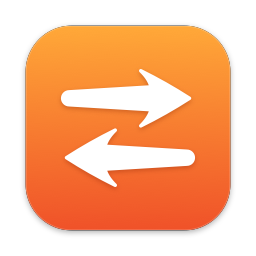
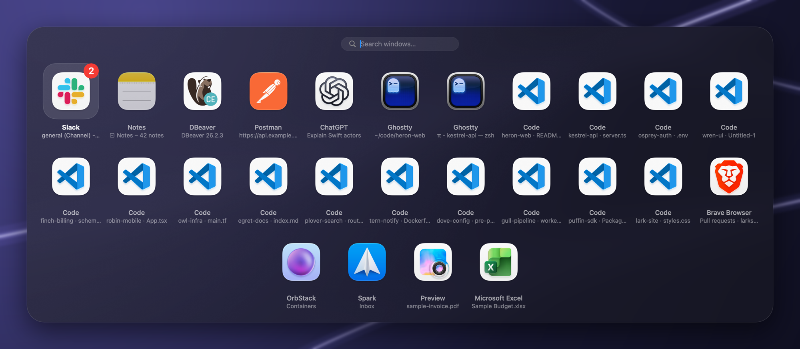
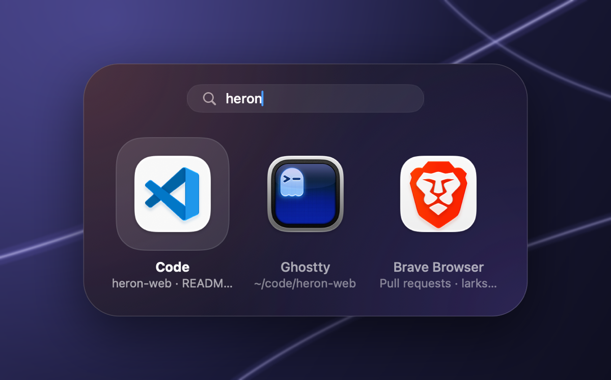
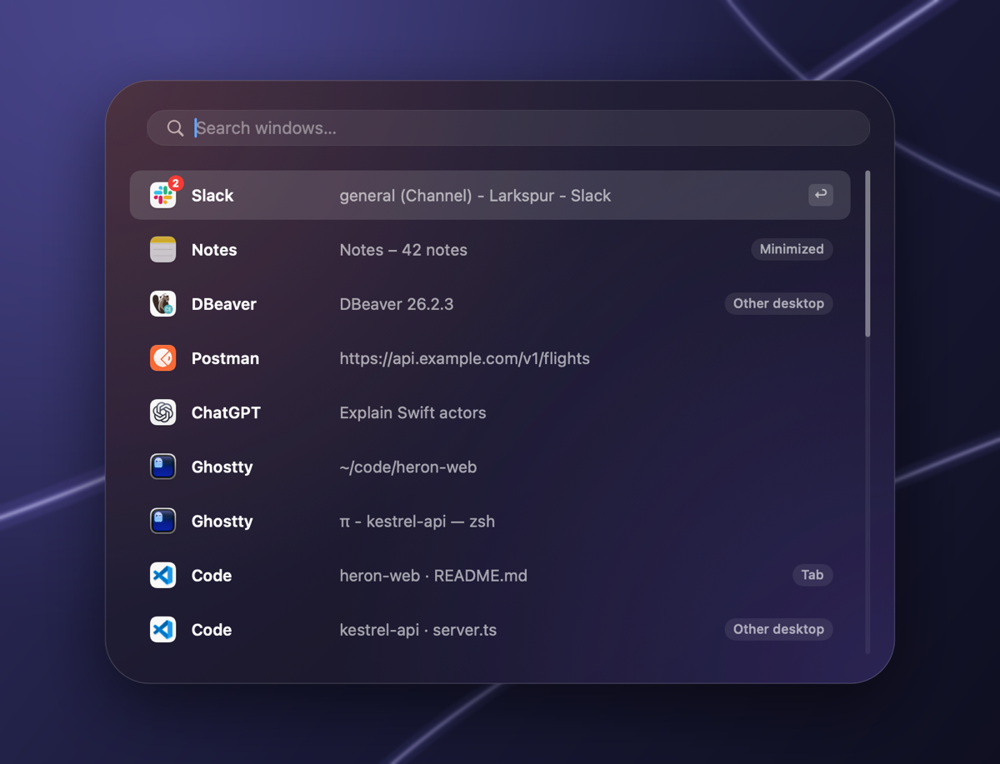
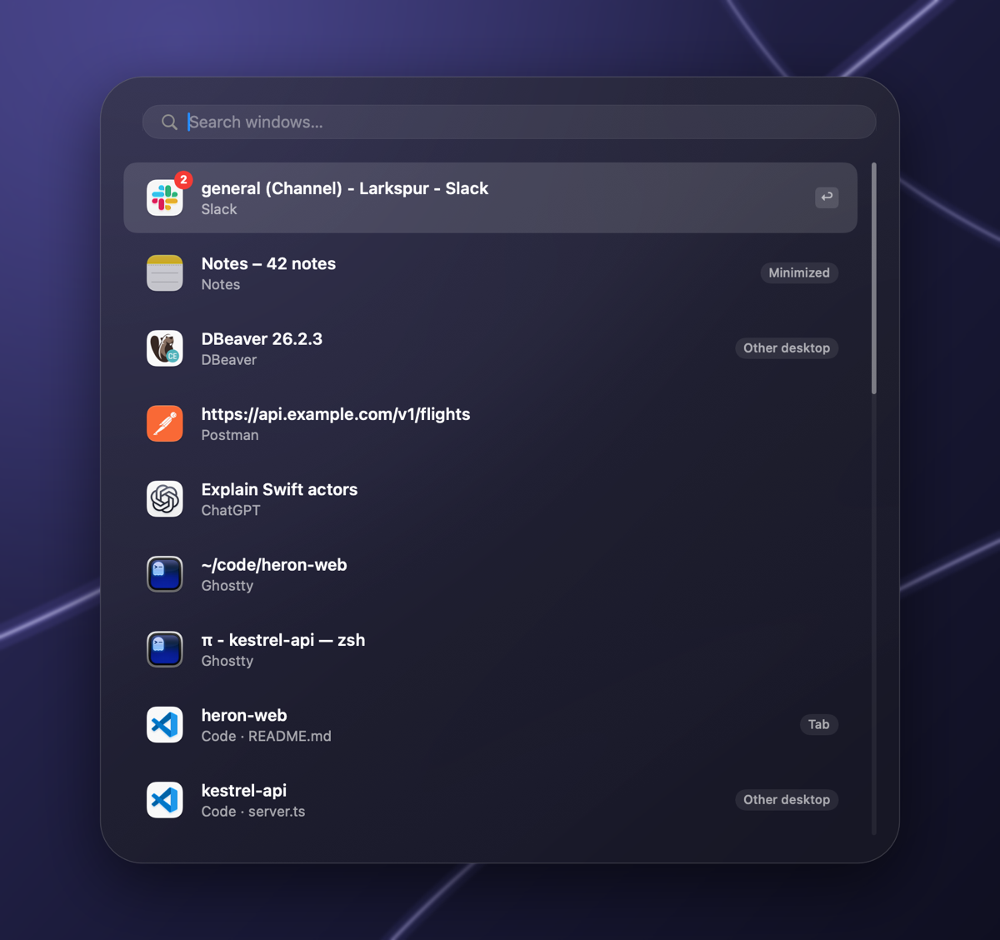

<div align="center">



# Swoop

**Just a window switcher for macOS.**
Press <kbd>⌥</kbd> <kbd>Tab</kbd>, type a few letters, hit <kbd>Return</kbd>. You're there.

[](https://github.com/bastienff/swoop/actions/workflows/release.yml)
[](https://github.com/bastienff/homebrew-tap)


[](https://github.com/bastienff/swoop/stargazers)
[](https://buymeacoffee.com/bastienff)

<br>


</div>

---

<kbd>⌘</kbd> <kbd>Tab</kbd> switches **apps**. Mission Control shows **everything** but you can't type
in it. Swoop does one thing: it shows **every window**, from every app on every desktop, in one
grid you can search. Pick one and Swoop takes you to it **on its own desktop**, without moving it.

That's it. No tiling, no window management, no plugins.

## Features

- **Every window, one grid.** All apps, all desktops (Spaces), minimized windows, and native
  window tabs. Ten VS Code windows show up as ten entries.
- **Type to find.** Fuzzy search across app names, window titles and tab titles. The grid shrinks to
  the matches as you type.

  <p align="center"></p>

- **Goes to the window, doesn't move it.** Swoop jumps to the desktop the window lives on.
  It never pulls windows onto your current desktop, and never pulls a tab out of its group.
- **Keyboard first.** The panel stays open after you let go of the keys. Use arrows, Tab, or
  <kbd>⌥</kbd> <kbd>Tab</kbd> again to move, <kbd>Return</kbd> to switch, <kbd>Esc</kbd> to close.
- **Grid or list.** Big icons in a grid, or a list with one-line (*Compact*) or two-line
  (*Comfortable*) rows that also show if a window is a tab, minimized, or on another desktop.
  [See both lists below](#grid-or-list).
- **Most recent first.** With an empty search, the window you used last comes first.
- **Made for VS Code.** Project names are pulled out of window titles, so you can type
  `api` and see projects, not file names. Works great with `"window.nativeTabs": true`.
- **Light.** Native Swift and AppKit. No dependencies and no polling: Swoop only wakes up when a window changes, so it sits at 0% CPU while nothing is happening.
- **One permission.** Needs only Accessibility. No Screen Recording, no Input Monitoring, and no network requests without your consent.

## Grid or list

The grid is the default. If you'd rather read than look for icons, switch to a list in
**Settings → Appearance → Layout**. Both lists show the same windows, search the same way,
and use the same keys. They just give each window a row.

<table>
  <tr>
    <td align="center"><br><b>List · Compact</b><br><sub>One line per window. Fits the most rows.</sub></td>
    <td align="center"><br><b>List · Comfortable</b><br><sub>Title or project first, app below. Easiest to scan.</sub></td>
  </tr>
</table>

The small labels on the right tell you where a window is: **Tab** (a native tab in a group),
**Other desktop**, **Minimized**, or **Full screen**. Lists show 9 rows by default, then scroll; you
can set 3 to 20.

## Install

### Homebrew

```sh
brew install --cask bastienff/tap/swoop
```

> Swoop runs on Apple silicon Macs with macOS 14 or later. Each GitHub release also updates the
> Homebrew tap, so `brew upgrade` picks up new versions.

### Download

Grab the latest `Swoop.dmg` from [Releases](https://github.com/bastienff/swoop/releases), open it,
and drag **Swoop** to **Applications**. (`Swoop.zip` has the same app, if you prefer a zip.)
Releases are signed with a Developer ID and notarized by Apple, so macOS opens Swoop without warnings.
To hear about new versions, click **Check for Updates** in Settings → Behavior or About, or turn on
*Check for updates automatically* there (off by default).

### First launch

Swoop lives in the menu bar. The first time you open it, macOS asks for **Accessibility**
access (System Settings → Privacy & Security → Accessibility). Swoop needs it to see your
windows and bring them forward. Then press <kbd>⌥</kbd> <kbd>Tab</kbd>.

Turn on **Launch at login** in Settings → Behavior so Swoop is always ready. It also lets
Swoop learn about windows as they open.

## Usage

| | |
|---|---|
| Open | <kbd>⌥</kbd> <kbd>Tab</kbd> (you can change it) |
| Search | Just type |
| Move | <kbd>←</kbd> <kbd>→</kbd> <kbd>↑</kbd> <kbd>↓</kbd>, <kbd>Tab</kbd> / <kbd>⇧</kbd> <kbd>Tab</kbd>, or <kbd>⌥</kbd> <kbd>Tab</kbd> / <kbd>⌥</kbd> <kbd>⇧</kbd> <kbd>Tab</kbd> again |
| Switch | <kbd>Return</kbd> or click |
| Close | <kbd>Esc</kbd> or click outside |

**Settings** (menu-bar icon → Settings…) cover the shortcut, layout (grid or list), light/dark
appearance, icon size, number of rows, which display the panel opens on, and which windows to include.

## What Swoop won't do

Swoop stays small on purpose. These are out of scope, and feature requests for them will be
politely declined:

- Window previews or thumbnails (those need Screen Recording permission)
- Tiling, snapping, resizing or arranging windows
- Creating, renaming or managing desktops
- Browser tabs, or tabs that apps draw themselves
- Plugins, scripting, themes

Bug reports and anything that makes **switching** faster or more reliable are very welcome.

## How it works

macOS has no public way to list windows by desktop, or to jump to a desktop. Swoop combines what
the Accessibility API does offer: the windows on the current desktop, each app's Window menu
(which lists all its windows), native tab groups, and the app's main window. To switch, it makes the
exact window the app's main window and activates the app. macOS then goes to that window's desktop
by itself.

Swoop remembers windows it has already seen. Those handles are lost when Swoop quits, so it
also uses one non-public Accessibility function to rebuild them after a restart. This is optional
(Settings → Behavior → *Remember windows on other desktops*). If a macOS update removes it,
Swoop falls back to public APIs on its own.

Every platform claim was tested on a real Mac, and the results are written down in
[`docs/ARCHITECTURE.md`](docs/ARCHITECTURE.md). That includes one trap Swoop avoids: picking a
hidden tab from an app's Window menu pulls the whole tab group onto your current desktop.

## Limitations

- Swoop can only reach a window that has been seen at least once. That means a window opened
  before Swoop first ran, on a desktop you haven't visited since, can't be reached yet. Visiting
  that desktop once fixes it, and launching at login avoids it.
- Several windows of the same app with **identical titles** on unvisited desktops can't be told
  apart. Swoop says so instead of guessing.
- Desktop numbers and names aren't shown, because macOS has no public API for them.
- Multiple displays are supported but haven't been tested much yet.

More detail: [`docs/ARCHITECTURE.md` §10](docs/ARCHITECTURE.md#10-known-limitations).

## Privacy

Swoop makes no network requests without your consent. The only one it can make is an update check:
it asks GitHub for the latest version number when you click **Check for Updates**, or once a day if you
turn on automatic checks (off by default). Nothing about you or your windows is sent, and it never
downloads or installs anything by itself. Your recent-windows history is stored in
`~/Library/Application Support/Swoop/` and never leaves your Mac.

## Build from source

Requires an Apple silicon Mac with macOS 14+ and Xcode 16+.

```sh
git clone https://github.com/bastienff/swoop.git
cd swoop
scripts/build.sh Release      # → build/Swoop.app
scripts/test.sh               # unit tests (Packages/SwoopCore)
open build/Swoop.app       # launch with `open` so macOS attributes permissions to the app
```

README images are made from the real panel with demo windows: run a Debug build, then
`build/swctl demo`, `build/swctl show`, `build/swctl snapshot <png> clear`, and composite with
`Tools/make_readme_assets.swift`. Never capture your real windows: their titles end up public.

`scripts/build.sh` signs with your first *Apple Development* certificate, so the Accessibility
permission survives rebuilds. Without one, it signs ad hoc and macOS asks for the permission again
after every build.

The code is split into a pure-Swift core (`Packages/SwoopCore`: search, grid, merging, ordering,
fully unit-tested) and the app (`Swoop/`: Accessibility, activation, UI). Start with
[`docs/ARCHITECTURE.md`](docs/ARCHITECTURE.md): the rules that must not regress, and the verified
platform facts behind them.

Want to help? Read [`CONTRIBUTING.md`](CONTRIBUTING.md). Found a security issue? See [`SECURITY.md`](SECURITY.md).

Publishing a new version is automated: a GitHub release builds the app and updates the Homebrew
cask.

## Support

<div align="center">

**Did Swoop just swoop you to the right window?**

Swoop is free, has no ads and no tracking, and it stays that way.
If it saves you a few hundred <kbd>⌘</kbd> <kbd>Tab</kbd>s a day, swoop by and gift me a coffee.
It keeps the switcher fast and the developer awake. ☕

<a href="https://buymeacoffee.com/bastienff"></a>

No coffee budget? A star is free and helps other Mac users find Swoop. ⭐

<a href="https://github.com/bastienff/swoop"></a>

The coffee link also lives in the menu bar (**Buy Me a Coffee ♥**), and both show up now and then in a small card after a switch.

</div>

## License

[MIT](LICENSE)
