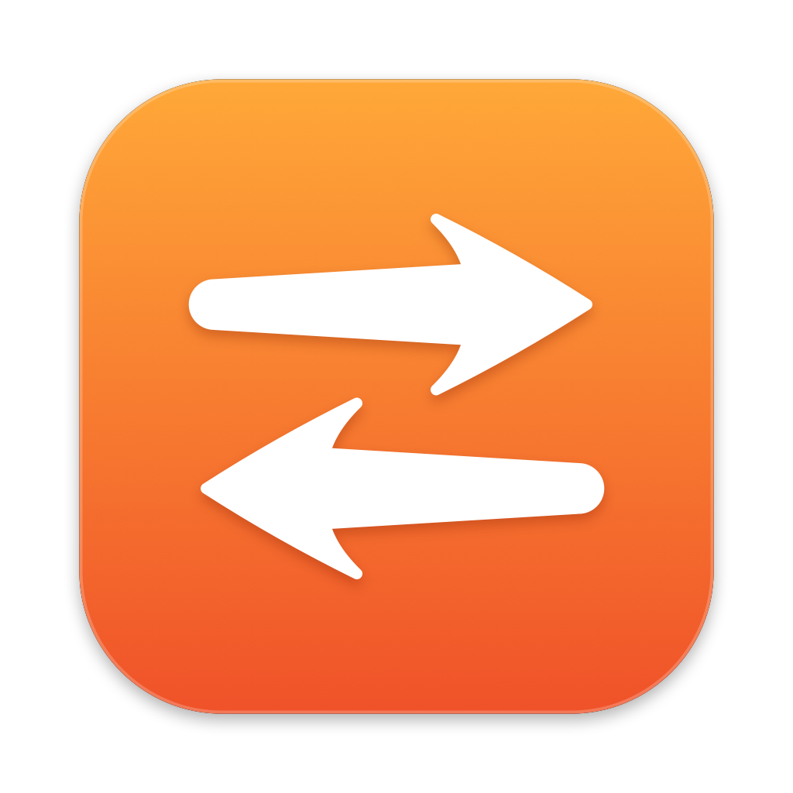

# Swoop logo

Two swap arrows on a warm orange squircle: → on top, ← below. Each arrow starts from a round tail, thickens
toward the head, and ends in a head with rounded corners and swept-back barbs. The shape says what Swoop
does (switch, fast) without the generic look of straight arrows.

Adopted 2026-11. The previous logo is in [`archive/v1-straight-arrows/`](archive/v1-straight-arrows/).

## Files

| File | What |
|---|---|
| [`icon/swoop-icon-1024.png`](icon/swoop-icon-1024.png) | App icon master, 1024 px |
| [`menu-bar/menubar-template.png`](menu-bar/menubar-template.png) | Menu bar glyph, normal (template, drawn black; macOS tints it). 72 px = 18 pt @4x |
| [`menu-bar/menubar-update.png`](menu-bar/menubar-update.png) | Menu bar glyph when an update is available (orange square, white arrows) |
| [`menu-bar/swoop-glyph.svg`](menu-bar/swoop-glyph.svg) | The arrows as an 18 × 18 SVG (white) for web pages, e.g. the logo tile in `design-system.html` |

The shipped assets are generated from code, which is the source of truth:

| Where | Source | Regenerate |
|---|---|---|
| App icon set (`Swoop/Assets.xcassets/AppIcon.appiconset`, also used by the README, About, onboarding, DMG) | `Tools/make_icon.swift` | `swift Tools/make_icon.swift Swoop/Assets.xcassets/AppIcon.appiconset docs/design/brand/icon/swoop-icon-1024.png` |
| Menu bar glyph | `MenuBarController.statusImage` (vector, drawn at runtime) | Rebuild the app |
| Social preview (`docs/images/social-preview.png`) | `Tools/make_readme_assets.swift` | See the tool's header; upload the result in the GitHub repo settings |
| Web pages in this folder | Inline copy of `menu-bar/swoop-glyph.svg` | Paste the new SVG |

## Construction

Unit icon space (0…1, y up). The squircle is `0.1…0.9` with corner radius `0.18`.

| Part | Value |
|---|---|
| Background | Linear gradient, top `#FFA838` (1.00, 0.66, 0.22) → bottom `#F05229` (0.94, 0.32, 0.16) |
| Squircle shadow | Black 30 %, blur 2 %, offset 0.8 % down |
| Rim | White 22 % hairline, 0.4 % |
| Top arrow (→) | Centerline y `0.616`; tail center x `0.27`; head starts at x `0.60` |
| Shaft | Width `0.05` at the tail (round cap) → `0.09` at the head, linear |
| Head | Length `0.14`, span `0.215`, barbs swept back `0.05`; outer edges bow out 10 %, back edges curve in |
| Corners | Every corner rounded by a `0.014` round-join stroke |
| Bottom arrow (←) | The top arrow turned 180° around the center |
| Arrow color | White, both arrows (no two-tone) |
| Arrow shadow | Warm brown `rgba(128, 26, 0, 0.32)`, blur 1.6 %, offset 0.8 % down |

Menu bar (18 pt): the same arrow, a little heavier so it holds up at 1×: y `11.3`, tail x `4.4`, head at x
`11`, shaft `1.3 → 2`, head length `3.1`, span `5`, sweep `1.1`, corner rounding `0.35`, knocked out of a
16 pt rounded square (radius 4).

Keep `Tools/make_icon.swift`, `MenuBarController.statusImage` and `menu-bar/swoop-glyph.svg` in sync: a
change to the arrow changes all three.

## Usage

- **Light icon only.** There is no dark variant of the icon for now.
- Menu bar: monochrome template normally; orange square with white arrows when an update is available. Both
  use the arrow above. Never the old straight arrows.
- Don't recolor the arrows, add a second tone, outline the icon, or place it on a busy background without its
  own squircle.
- Product name next to the icon is **Swoop** (capitalized).
